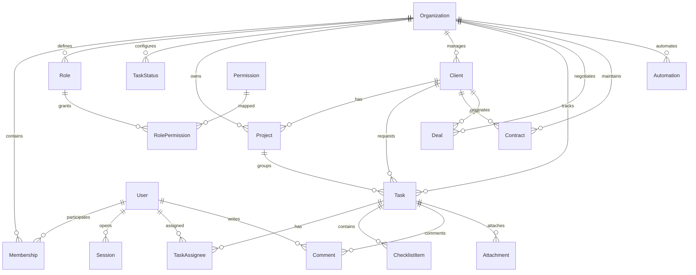

# LoboFlow — Estrutura de Banco de Dados e Multi-Tenancy

## 1. Princípios de Modelagem
- **UUIDs Universais:** Identificadores primários utilizam o tipo nativo `uuid` do PostgreSQL.
- **Isolamento Relacional:** Todas as entidades de escopo empresarial possuem a coluna `organizationId`.
- **Integridade Referencial Forte:** Relações utilizam chaves compostas para garantir que entidades correlatas pertençam ao mesmo locatário. Exemplo na entidade `Task`:
  ```prisma
  status   TaskStatus @relation(fields: [organizationId, statusId], references: [organizationId, id], onDelete: NoAction)
  project  Project?   @relation(fields: [organizationId, projectId], references: [organizationId, id], onDelete: NoAction)
  client   Client?    @relation(fields: [organizationId, clientId], references: [organizationId, id], onDelete: NoAction)
  ```
- **Precisão Financeira:** Valores monetários armazenados como centavos inteiros (`Int` ou `BigInt`), impedindo imprecisões de arredondamento de ponto flutuante.
- **Datas Limpas:** Prazos e datas sem necessidade de fuso horário utilizam o tipo `@db.Date`.
- **Auditoria e Rastreabilidade:** Trilha dupla — `AuditLog` (imutável, append-only para auditoria de segurança) e `Activity` (histórico funcional de mudanças exibido na interface de tarefas e projetos).

## 2. Diagrama de Relacionamento de Entidades (ERD)



## 3. Estratégia de Migrações e Seeds
- As migrações são geridas exclusivamente pelo **Prisma Migrate** e versionadas no Git em `apps/api/prisma/migrations`.
- O processo de inicialização de novas organizações executa automaticamente o seed dos dados padrão essenciais:
  1. Catálogo completo de permissões sincronizado.
  2. Papéis padrão (Proprietário, Administrador, Gestor, Colaborador, Comercial, Financeiro, Visualizador, Convidado).
  3. Status padrão do fluxo de tarefas (A fazer, Em andamento, Em revisão, Em alteração, Concluída, Cancelada).
