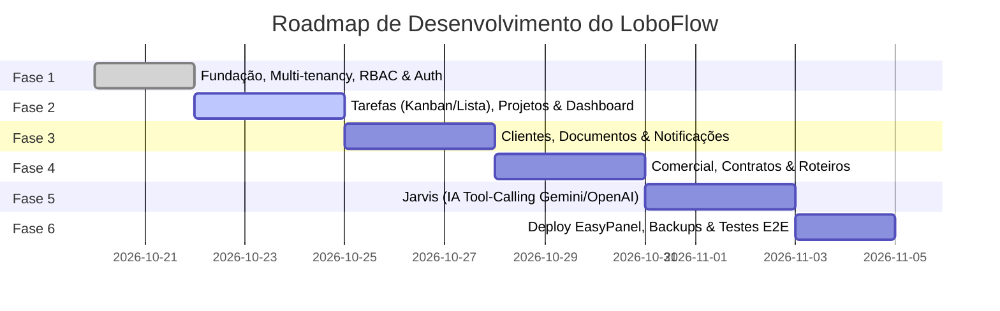

# LoboFlow — Roadmap de Implementação e Fases

## Visão Geral das Fases

## Detalhamento das Fases

### Fase 1 — Fundação (Atual)
- [x] Workspace pnpm com pacotes tipados `@loboflow/shared`, `@loboflow/validation` e `@loboflow/config`.
- [x] Banco de dados PostgreSQL configurado com migrações Prisma versionadas.
- [x] Constraints compostas multi-tenant `@@unique([organizationId, id])` para isolamento absoluto.
- [x] Autenticação com senhas Argon2id e sessões em cookies HttpOnly seguros.
- [x] Catálogo de permissões RBAC com escopos (`ALL`, `ASSIGNED`, `OWN`) e templates de papéis.
- [x] Script de bootstrap e proteção do SuperAdmin.

### Fase 2 — Produto Essencial
- [ ] Módulo completo de Tarefas (Kanban, Lista, prazos, prioridades, checklists, comentários).
- [ ] Módulo de Projetos com membros, clientes associados e cálculo automático de progresso.
- [ ] Dashboard operacional com métricas reais (tarefas atrasadas, a vencer, entregas e carga da equipe).

### Fase 3 — Arquivos e Colaboração
- [ ] Ficha de Clientes com perfil da agência (público-alvo, tom de voz, restrições).
- [ ] Gestão de Documentos com versionamento e links temporários assinados (S3/MinIO).
- [ ] Sistema de Notificações in-app e despachos de e-mail via fila assíncrona.

### Fase 4 — Operação Comercial e Marketing
- [ ] Biblioteca de Roteiros e conteúdo para redes sociais com versionamento e status de aprovação.
- [ ] Funil comercial (Negociações, motivos estruturados de perda, reabordagens).
- [ ] Gestão de Contratos e encerramentos auditados com cálculo de retenção.

### Fase 5 — Jarvis (IA Operacional)
- [ ] Adaptadores de IA para Google Gemini e OpenAI com streaming.
- [ ] Ferramentas de sistema tipadas (Níveis 1, 2 e 3 com modal de confirmação).
- [ ] Auditoria de execuções de ferramentas e limites de tokens por organização.

### Fase 6 — Produção
- [ ] Dockerfiles multi-stage para `api`, `worker` e `web`.
- [ ] Documentação de deploy no EasyPanel e scripts de backup/restauração.
- [ ] Testes automatizados de isolamento e fluxos ponta a ponta.
